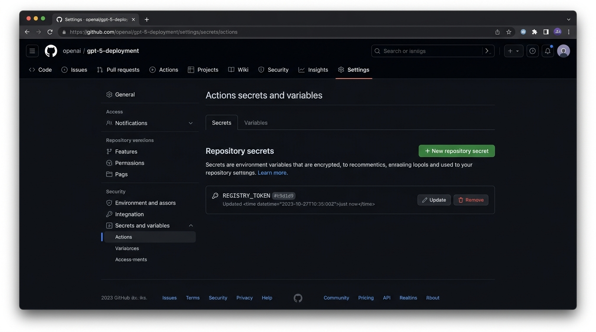

# Bài 4: Khai Báo GitHub Secrets & Cấu Hình Đăng Nhập Container Registry (GHCR)

## 1. Thông Tin Chung
- **Môn học:** IT209 - DevOps & Cloud Computing / CI/CD
- **Bài tập:** Bài 4 (Session 11) - Khai báo GitHub Secrets và cấu hình Đăng nhập Container Registry
- **Họ và tên sinh viên:** Đặng Thanh Bình
- **Mã sinh viên:** PTIT-HN-255
- **Lớp:** HN_KS24_CNTT2
- **GitHub Repository:** [HN_CNTT2_IT209_SESSION11_Bai04](https://github.com/binhptit2810/HN_CNTT2_IT209_SESSION11_Bai04)
- **Thư mục bài làm:** `homework/session_11/ex4/` (đồng thời hỗ trợ `homework/session_11/ex04/`)

---

## 2. Mục Tiêu Thực Hành
- **Bảo mật thông tin xác thực:** Tạo tệp bí mật mã hóa an toàn (**Repository Secret**) lưu trữ Token cá nhân trên GitHub nhằm tránh để lộ mật khẩu/token trong mã nguồn mở.
- **Tự động hóa xác thực Registry:** Cấu hình bước đăng nhập tự động vào **GitHub Container Registry (`ghcr.io`)** thông qua `docker/login-action@v3` trong luồng GitHub Actions CI.

---

## 3. Các Bước Triển Khai Chi Tiết

### Bước 1: Tạo Personal Access Token (classic) trên GitHub
1. Truy cập GitHub: **Settings** (Avatar góc phải) $\rightarrow$ **Developer settings** $\rightarrow$ **Personal access tokens** $\rightarrow$ **Tokens (classic)**.
2. Nhấn chọn **Generate new token** $\rightarrow$ **Generate new token (classic)**.
3. Điền các trường cấu hình:
   - **Note:** `REGISTRY_TOKEN` (hoặc `GHCR_TOKEN`).
   - **Expiration:** Thời hạn mong muốn (ví dụ 30 hoặc 90 ngày).
   - **Select scopes:** Tích chọn phạm vi quyền **`write:packages`** (hệ thống tự động kích hoạt `read:packages`).
4. Nhấn **Generate token** và sao chép chuỗi mã Token sinh ra dạng `ghp_...`.

---

### Bước 2: Khai báo Repository Secret `REGISTRY_TOKEN`
1. Truy cập vào Repository: [HN_CNTT2_IT209_SESSION11_Bai04](https://github.com/binhptit2810/HN_CNTT2_IT209_SESSION11_Bai04).
2. Vào **Settings** $\rightarrow$ Menu bên trái chọn **Secrets and variables** $\rightarrow$ chọn **Actions**.
3. Nhấn nút xanh **New repository secret**.
4. Nhập các giá trị:
   - **Name:** `REGISTRY_TOKEN` *(Chính xác tên này)*.
   - **Secret:** Dán chuỗi Personal Access Token vừa copy ở Bước 1.
5. Nhấn **Add secret**.

#### Hình ảnh minh chứng mục Repository Secrets hiển thị biến REGISTRY_TOKEN:


---

### Bước 3: Cấu hình kịch bản CI (`.github/workflows/ci.yml`)

Khai báo bước đăng nhập `docker/login-action@v3` truyền vào biến `secrets.REGISTRY_TOKEN`:

```yaml
name: CI Pipeline

on:
  push:
    branches: [ "main", "master" ]
  pull_request:
    branches: [ "main", "master" ]
  workflow_dispatch:

jobs:
  docker-login:
    name: Build & Login Registry
    runs-on: ubuntu-latest
    steps:
      - name: Checkout mã nguồn
        uses: actions/checkout@v4

      - name: Đăng nhập vào GitHub Container Registry
        uses: docker/login-action@v3
        with:
          registry: ghcr.io
          username: ${{ github.actor }}
          password: ${{ secrets.REGISTRY_TOKEN }}
```

---

## 4. Dữ Liệu Thực Nghiệm & Kiểm Tra Kết Quả

- **Lượt chạy Workflow:** [Run ID 38260760165](https://github.com/binhptit2810/HN_CNTT2_IT209_SESSION11_Bai04/actions/runs/38260760165)
- **Job Name:** `Build & Login Registry` (Job ID: `114850337899`)
- **Trạng thái:** `Success` (Hoàn thành thành công)

### Trích xuất Log chi tiết từ GitHub Actions Runner:
```text
Download action repository 'docker/login-action@v3' (SHA:c94ce9fb468520275223c153574b00df6fe4bcc9)
Complete job name: Build & Login Registry

##[group]Run docker/login-action@v3
with:
  registry: ghcr.io
  username: binhptit2810
  password: ***
  logout: true
##[endgroup]
Logging into ghcr.io...
Login Succeeded!

Post job cleanup.
##[group]Logout from ghcr.io
[command]/usr/bin/docker logout ghcr.io
Removing login credentials for ghcr.io
##[endgroup]
```

> **Kết quả:** Runner hiển thị chính xác dòng **`Login Succeeded!`**, xác nhận `REGISTRY_TOKEN` đã giải mã và xác thực hợp lệ với `ghcr.io`.

---

## 5. Sản Phẩm Nộp Bài
1. **Tệp kịch bản CI:** [.github/workflows/ci.yml](.github/workflows/ci.yml) (có bước `docker/login-action@v3`).
2. **Ảnh chụp màn hình:** [image.png](image.png) minh chứng mục **Repository Secrets** hiển thị biến `REGISTRY_TOKEN` đã khởi tạo.
